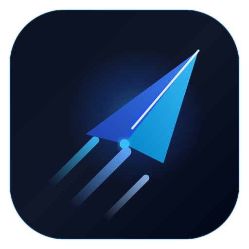
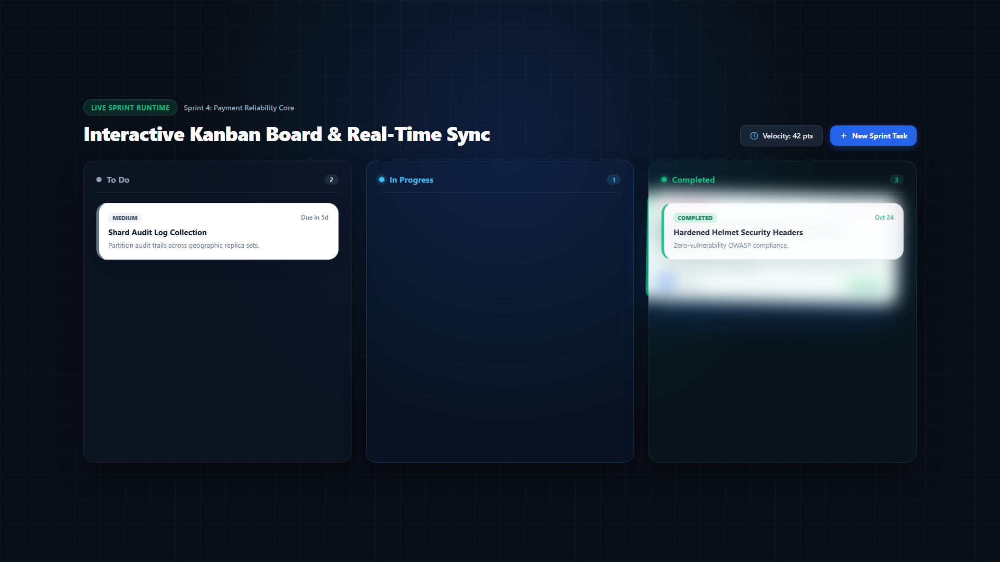

<p align="center">
  <a href="https://project-pilot-two.vercel.app/">
    
  </a>
</p>

<h1 align="center">Project Pilot</h1>

<p align="center">
  <strong>Modern Agile Sprint Management and Team Collaboration Platform</strong>
</p>

<p align="center">
  <a href="LICENSE"></a>
  <a href="client/"></a>
  <a href="server/"></a>
  <a href="#"></a>
  <a href="#"></a>
  <a href="server/tests/"></a>
  <a href="#"></a>
</p>

<p align="center">
  <a href="https://project-pilot-two.vercel.app/">Live Demo</a> &bull;
  <a href="#launch-showcase">Launch Video</a> &bull;
  <a href="#features">Features</a> &bull;
  <a href="#tech-stack">Tech Stack</a> &bull;
  <a href="#quickstart">Quickstart</a>
</p>

---

## Overview

Project Pilot is a full-stack agile project management and sprint delivery platform. It enables software teams to organize backlogs, track card movements across real-time Kanban boards, coordinate milestone deliverables, and automate outbound team notifications without communication friction.

* **Live Demo:** [https://project-pilot-two.vercel.app/](https://project-pilot-two.vercel.app/)
* **Repository:** [https://github.com/Divyanshkumar62/project-pilot](https://github.com/Divyanshkumar62/project-pilot)

---

## Launch Showcase

<p align="center">
  <a href="assets/showcase.mp4">
    
  </a>
</p>

<p align="center">
  <em>Click the poster preview above or <a href="assets/showcase.mp4">play the high-definition product walkthrough (assets/showcase.mp4)</a> to view the full product experience.</em>
</p>

---

## Features

* **Real-Time Kanban Boards:** Interactive drag-and-drop task workflow powered by `@dnd-kit` with instant multi-user board synchronization via Socket.io.
* **Threaded Task Collaboration:** Built-in task discussions with author avatars, live comment counters on cards, and permission-gated deletion.
* **Granular Role-Based Permissions:** Two-tier access control separating Workspace Owners, Managers, and Members with secure invitation links.
* **Sprint Milestone Tracking:** Plan sprint deliverables, assign target deadlines, and monitor real-time completion velocity across active projects.
* **Outbound Webhook Integrations:** Automated event dispatches for task and milestone updates secured with HMAC-SHA256 signatures for Slack, Discord, and custom endpoints.
* **Executive Backlog Exports:** One-click structured CSV downloads and print-optimized PDF summary reports for sprint planning and stakeholder reviews.
* **Template Backlog Library:** Ready-to-use workspace templates for common engineering backlogs including Bug Triage, Mobile Release, and API Redesign.
* **Centralized Account Settings:** User management suite with custom profile avatars (< 2MB), bio headlines, active timezone configuration, and credential updates.
* **Automated Data Maintenance:** Hourly background service with seed data protection ensuring preview stability without manual database resets.

---

## Tech Stack

* **Frontend:** React 18, Vite, Tailwind CSS, TanStack React Query, Framer Motion, Recharts, Lucide Icons
* **Backend:** Node.js, Express 4, Socket.io, Mongoose, Helmet, Express Rate Limit, BCrypt, JWT
* **Database:** MongoDB
* **Testing:** Jest, Supertest, MongoDB Memory Server
* **DevOps:** Docker, Docker Compose, GitHub Actions CI/CD

---

## Quickstart

### Prerequisites
* Node.js 18+ and npm
* MongoDB instance (local or MongoDB Atlas)

### 1. Backend Server Setup
```bash
cd server
npm install

# Create environment configuration
cp .env.example .env

# Start development server
npm run dev
```

### 2. Frontend Client Setup
```bash
cd ../client
npm install
npm run dev
```
The client starts on `http://localhost:5173` with hot-module reloading enabled via Vite.

---

## Automated Testing

Project Pilot includes an automated test suite testing authentication, authorization, CRUD lifecycle, and validation against an isolated, in-memory MongoDB server.

```bash
cd server

# Run all test suites
npm test

# Run tests with code coverage report
npm run test:coverage
```

---

## Docker Orchestration

Run the entire platform (Client, Server, and MongoDB) with a single command:

```bash
docker compose up --build
```

Access the application at `http://localhost:5173` with the backend API listening at `http://localhost:5001`.

---

## License

Distributed under the [MIT License](LICENSE).
